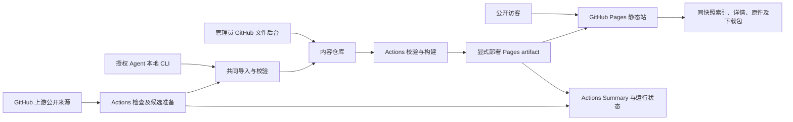

# Skill Gallery 技术方案

> 状态：关键架构决策已确认，可进入开发 · 版本：0.2 · 日期：2026-11-01
> 基线：[DemandAnalysis.md](DemandAnalysis.md) 0.2。文中的新模块、命令和流水线均为设计，尚未实现。

本方案按“应用架构 → 管理与使用闭环 → 集成验证”展开。公开站点继续由原生 JS 和 GitHub Pages 承载，后台复用 GitHub 仓库与 Actions；站点原地址不变。Q-001～003 已由用户确认：GitHub 后台、GitHub 首版自动更新、当前单版本并保留 Git 历史。专用管理后台不属于本轮范围，未来变更需先修订 DEC-001、DEC-006。

# 第一部分：应用架构与能力设计

## 1. 总体选择及依据

<a id="decisions"></a>
### 1.1 关键决策

| ID | 问题/关联需求 | 候选与推荐选择 | 代价、状态与复议条件 |
|---|---|---|---|
| DEC-001 | 地址与管理环境；FR-005、FR-007、FR-011 | A：Pages + GitHub 后台 + Actions（已选择）；B：Pages + 外部 API/专用后台；C：整站迁移全栈（不满足原托管约束的直接方案） | Q-001 已确认 A；管理体验偏开发者，无独立应用后台。未来改 B 须明确认证、执行环境、预算，公开地址仍不变 |
| DEC-002 | 原件保真；FR-001、FR-003、FR-004 | 原件按字节保存，搜索/展示为派生产物；不再从纯文本重建原文 | 构建产物变多，但修复内容损失；不能以节省索引为由合并字段 |
| DEC-003 | 第三方元数据兼容；FR-001、FR-008 | 图库 JSON 记录与原件分离；成熟 YAML 解析器仅读取元数据；不重写原件 | 引入有限依赖，放弃原“手写解析、绝无 npm 包”约束；来源规范变化时再演进 schema |
| DEC-004 | 检索与 UI；FR-002、FR-010 | 复用原生 JS，精准子串与中文 fallback，英文 MiniSearch；仅新增必要模块，不引入框架和后端搜索 | 不能做中文语义检索；容量超候选目标或真实需求变化时复议 |
| DEC-005 | 展示第三方 Markdown；FR-003、FR-007 | 构建时解析 Markdown 并清理 HTML，浏览器仅展示清理后片段；原件下载保持不变 | 清理策略可能不展示活动 HTML；安全与相对路径 PoC 需先通过 |
| DEC-006 | 上传通道；FR-005、FR-006、FR-007 | 采用 GitHub 手动提交及本地 Node CLI + Git 提交，共用 ingest/validate；来源 URL 可经授权 workflow_dispatch 导入 | Q-001 已确认；不在浏览器存 GitHub token，不用 Issue 留言当写入权限 |
| DEC-007 | 单版本与升级；FR-008 | 采用 GitHub adapter、固定 SHA 获取、内容 hash 判断、完整目录替换；站内记录隔离；Git 历史可恢复 | Q-002/003 已确认；非 GitHub 来源手动维护，保留 Git 历史。许可变化、本地改动暂停覆盖 |
| DEC-008 | 一致性与发布；FR-009、FR-011 | 校验、候选构建通过后提交，构建提交快照并在同一 workflow 显式部署；线上切换一个 Pages artifact | Git 提交与 Pages 发布不是跨系统原子事务；部署失败记录并重跑，禁止报告整体成功 |
| DEC-009 | 迁移；FR-011 | 保留旧 slug/Hash 路由和原件路径，生成新的图库记录；旧 spec/plan 标记历史 | 不自动发布未跟踪文件；不为统一格式重命名存量技能 |

### 1.2 技术栈、来源与版本边界

| 项 | 现状 / 推荐 | 核实与后续验证 |
|---|---|---|
| Node.js | 本机 `v26.3.0`；构建脚本 CommonJS | 本次已运行两份 JS 语法检查；CI 运行时实施前选受支持版本并固定，不要求恰好等于本机版本 |
| 前端 | 原生 HTML/CSS/JS，保留 Hash 路由 | 当前结构已审阅；新模块如需要通过构建复制/打包到站点，不引入框架重写 |
| YAML / Markdown / HTML 清理 | 拟采用成熟、锁版本的 YAML 解析器、Markdown renderer 和 HTML sanitizer | 具体包及精确版本由 US-001 PoC 决定；当前 marked CDN 未锁版本不能继续原样依赖，不提供未经核实 API 示例 |
| MiniSearch | 当前 HTML 引用 `6.3.0`；拟本地静态分发已锁定版本 | 实施前核实官方 API；验证中英分词、子串 fallback，不拿英文 fuzzy 当中文语义检索 |
| ZIP | 构建时生成完整目录包，复用成熟打包库 | 库和版本待 PoC；按路径、字节及二进制夹具验证，无需手写压缩格式 |
| GitHub Pages / Actions | 官方静态发布和事件/计划能力 | [R-005～008、011](IndustryResearch.md)；本次经 Context7 查询与官方资料核实；Actions 的精确 release/SHA 实施前再锁定 |
| GitHub API / CLI | 固定提交读取来源；`gh workflow run` 可触发授权工作流 | [GitHub Contents](https://docs.github.com/en/rest/repos/contents)、[gh workflow run](https://cli.github.com/manual/gh_workflow_run)；只核实能力，未做远程写入 |

不把“尚未选库”等价于“可随意用 latest”；依赖选定后记录包名、版本、锁文件、许可和最小使用能力。

2026-11-02 工程基线补充（不改变 0.2 业务契约）：按用户授权先建立根 CommonJS/npm 工程及 Node 26.3.0 本地基线。
仅增加开发检查依赖：ESLint 10.14.0、@eslint/js 10.0.1、globals 17.14.0、Prettier 3.9.10、eslint-config-prettier 10.1.8；均为 MIT，精确锁入 package-lock。
Node 内建测试显式限定受信任目录；安全检查使用独立本地 Gitleaks 8.30.1（MIT）、Semgrep CE 1.183.0（LGPL-2.1）和根 npm audit。
Semgrep 通过 uv 的独立工具环境安装，不改变站点的 npm 包管理方式；扫描器不进入生产产物。
此项仅支撑 NFR-003/NFR-006、DEC-005/009，不能替代 C-01/03 内容校验与业务 PoC；首次工程初始化未包含 Actions、部署及线上监控；下述提前建设授权仅覆盖只检查 CI 与现站基础监测，生产发布链仍属 US-003。

### 1.3 提前建设检查 CI 与现站监测（2026-11-02）

用户已授权在业务编码前补齐检查型 CI 和现有网站基础可用性监测，不改变四份 0.2 业务契约或宪章 1.0.0。
复用 GitHub Actions；与外部监控服务相比，免去额外账号/凭证和后台，代价是定时运行非严格 SLA、通知依赖 GitHub 设置。

- `.github/workflows/quality.yml`：所有 push、PR、手动触发；固定 Node/npm/uv，安装固定扫描器后显式执行 check、Gitleaks、Semgrep 和依赖审计，任一失败汇总为失败。
- `.github/workflows/site-monitor.yml`：默认分支定时/手动触发，仅用 Node 读取现站，无依赖安装和发布。
- `scripts/check-site.js`：固定 https://chengxuan2002-droid.github.io/skill-gallery/，检查首页、app.js、style.css、search-index.json。
  校验 HTTP 200、匹配 MIME、非空内容；首页身份标识与旧版索引结构可辨识，不能把返回 200 的错误页当作正常。
- 单请求超时 8 秒，失败重试一次，所有资源分别给出状态；不执行下载的 JS/Skill、不打印响应正文或任意网络错误。
- 工作流只读权限，checkout 不保留凭证，第三方 Action 固定完整 SHA，PR 不使用特权触发器；无部署、写回、Issue/邮件机器人或原始报告上传。
- 监测已按用户确认改为每小时一次、避开整点（每小时第 7 分）；以 workflow cron 为准，不是来源自动更新 Q-004 的周期决定。
- 失败通过 Actions 运行状态呈现，通知依照维护者自己的 GitHub 设置；未推送默认分支前只算本地配置/验证，不能称定时已启用。

映射 FR-011、NFR-003/004/006、DEC-001/008/009，AC-014 的工程/可用性支撑子集。
不覆盖浏览器交互、JS 异常采集、完整原件下载一致性或生产发布验收；索引切换新版契约时同步调整监测断言。

## 2. 架构与外部边界



图为 Q-001 已确认方案；没有常驻服务器、数据库或浏览器写入 token。公开站点只读取静态产物。GitHub UI 的授权由 GitHub 控制，本地 Agent 的授权由已有 Git/gh 会话承担。站点可提供“管理”外链，不呈现访客登录表单。

依赖方向：入口 → M-05、M-06 → M-01、M-02 → M-03 → M-07；M-04 只读取 M-03 产物。原件、图库记录和跟踪状态由 M-02 管理，入口不能分别发明字段和覆盖规则。

## 3. 核心能力设计

### 3.1 原件、元数据及校验（M-01、M-02；DEC-002、DEC-003、DEC-009）

保留 `skills/<slug>.md` 和 `skills/<slug>/SKILL.md` 两种来源，新增 `catalog/<slug>.json` 作为图库元数据与来源配置。原件和附件原样保存，不把图库字段灌回第三方 `SKILL.md`。旧顶层 `name` 可能是中文显示名，不据此判为标准技能 ID；站内 slug、display_name 与上游 skill_name 分开。

M-01 输出规范化记录和诊断，不写文件；M-02 负责读取、hash 和临时目录中的候选替换。完整解析 YAML，允许额外字段，禁止依赖 `split(':')` 解析复杂元数据。已存在 slug 需要 replace 及 expected_revision，不能默默覆盖。

候选输入限制建议：每 Skill 最多 500 文件、总量 20 MiB，主文档 1 MiB；为防止无界读取的初始工程参数，PoC 后固定并写入 README。允许普通二进制资源，拒绝符号/硬链接、设备文件、绝对路径、`..` 越界、隐藏凭证目录和 `.git`。合法点文件是否收录按公开白名单规则定义，不应继续“一刀切漏掉任何隐藏资源”又宣称保真。发现凭证疑似内容时仅报告位置和类型，不能打印值。

### 3.2 构建与完整分发（M-03；FR-003、FR-004、FR-011）

构建一次生成目录 `dist/`，不直接发布整个仓库。生成内容清单、搜索索引、每项详情 JSON、原始文件副本与 ZIP。主文档 body 从原件解析，渲染 HTML 仅用于展示；原始完整字节供下载和复制。单 `.md` 保留原名下载，目录 ZIP 保留根目录及相对结构，许可证和声明随内容分发。

Markdown 相对附件链接按该 Skill 的静态根路径解析；只允许映射到清单内文件。锚点留在文档；普通相对 `.md` 链接可链接到只读附件，不承诺额外 SPA 路由。外链仅 http/https，图片仅清单内资源或安全 http/https；清除脚本、事件、iframe 和活动 URL。禁止将原 Markdown 插入不经清理的 innerHTML，也禁止把文本转义工具当 HTML 属性转义的完整替代。

### 3.3 搜索与 UI（M-04；FR-002、FR-003、FR-010）

搜索索引包含规范化显示名称、简介、用途、用法、作者、标签、平台、来源及纯文本。精准模式直接匹配规范化片段；引号内片段必须完整匹配。模糊模式：英文以 MiniSearch 做词项检索与拼写容错，中文以连续片段保底；合并结果去重，命中名称优先，说明/标签次之，正文再次。明确不做向量或模型调用。

每个查询只执行一次搜索并生成 score map，再作集合筛选；不能在每张卡片 filter 内重复全库搜索。排序规则按 FR-002；给测试集固定同分 slug 次序。URL 推荐 `#/?q=...&mode=fuzzy&tag=...` 与 `#/skill/<slug>`，使用 URLSearchParams 编解码；旧详情链接完全兼容。查询参数只有可公开的筛选值。

视觉建议规格：页面最大宽度约 1,200px，桌面筛选栏约 240px；8px 间距基准、8～12px 圆角、正文约 16px；浅色灰白背景/深色近黑背景，单一蓝紫强调色用于主操作和命中。取值是设计建议，不是“主流 AI 网站”的客观标准。主操作为“下载完整 Skill”，次操作“复制链接/原文”，管理入口为低权重外链。站点中文，技术名保持原文。筛选采用真实 button/checkbox，卡片含真实链接，搜索有 label，键盘可达且减少动效偏好生效。

360px 单列且筛选折叠；768px 按实际可用宽度折叠/展开；1,440px 筛选与结果分栏。代码块内部横向滚动，页面整体不溢出。错误、空库、空结果和加载状态有恢复动作。视觉截图必须在实现时验证，不使用这次抓取文本作为截图证据。

### 3.4 手动与命令维护（M-05、M-07；Q-001 已确认）

手动流程：GitHub 后台上传原件与 `catalog` 记录 → commit → 校验构建发布。浏览器文件界面适合小目录，复杂目录交给 CLI；不做公开 ZIP 解包接口。README 用固定步骤解释所需记录字段，失败时指向运行结果。

CLI 在项目 checkout 或受控临时 checkout 中运行，读取本地路径/来源和元数据，通过 M-01、M-02 校验；preview 不写入、不发 push。publish 在隔离临时目录基于远端基线准备提交，只暂存该 Skill 的原件、图库记录和跟踪文件。不能使用 `git add .`、重置用户工作区或提交未跟踪的 `.agents/` 等文件。

成功提交后输出 commit_sha、run 查询入口与公开链接；只有观察到部署成功才输出 published。显式 `--wait` 可等待部署，否则返回 submitted。并发基于 expected revision 和 fast-forward 检查，远端变化则返回 conflict，不 force push。

### 3.5 来源升级（M-06、M-02；FR-008）

GitHub adapter 输入结构化 owner/repo/path 和策略，不靠解析任意页面 HTML 抓“最新版”。先解析来源分支或 Release 到不可变 commit SHA，再在该 SHA 读取精确文件/子树，获取所需文件与适用许可。可以使用官方 Git Trees/Blobs 接口逐层遍历；不接受截断目录结果，不跟踪子模块和符号链接。若选择其他下载实现，必须同样验证快照一致性和边界。

来源配置包括 `provider=github`、`repository`、`path`、`ref_policy=branch|release|pinned`、`ref`、`enabled`。Release 策略选择最新正常已发布 Release 并解析到 SHA；没有 Release 则报告 unavailable，不暗自退回分支。分支可有非 SemVer version，hash 才是变更判定依据。pinned 只检查目标可达，不自动漂移。

digest 建议 SHA-256，覆盖排序后的路径与每个文件原始字节，不能只 hash 主文档。读取当前已同步 digest 与实际当前内容比较：有本地改动则 conflict。准备候选目录、检验来源许可和文件边界、构建通过后再替换当前目录；替换必须移除上游已删除文件。站内 display_name、tags、notes、usage、enabled 不受覆盖；作者与声明版本等上游字段按记录的来源优先级更新。

### 3.6 状态与发布（M-07；FR-009、FR-011）

使用 Actions Summary 和运行记录作为完整维护日志；工作流 artifact 可输出逐项检查 JSON，CLI 根据 run ID 查询。网站可见的记录只放最近成功内容同步时间和来源标识；定期无变化检查时间由后台运行记录提供，无需每日为时间戳制造 Git 提交。若 artifact 过期，后台能说明无法读取历史明细，最新运行结果仍是依据，不声称永久审计保留。

流程候选：一个 `maintain.yml` 接收 default branch push、schedule 和 workflow_dispatch。普通 push 做全量校验与发布；schedule/dispatch 先检查授权与准备内容，校验、构建、提交后，显式在本次运行调用相同发布阶段。同步产生的 bot push 不作为启动发布的唯一依赖；无变更不部署；无变更但线上落后当前提交时可显式重发当前快照。

## 4. 并发、一致性与重试

定时/手动维护使用同一 concurrency group 排队，更新过程不被自动取消。串行配置不能阻止管理员直接 Git push，因此提交前仍比较远端基线；非 fast-forward 失败即 conflict，重新读取后重新计算，不能 force push。部署共享另一个全局发布组且不并行部署，防止旧快照覆盖新快照；发布前检查当前 HEAD 与目标 SHA，过时运行跳过并报告 superseded。

网络读取候选参数：单请求超时 30 秒，最多 3 次，仅网络错误/5xx 或按平台重试提示可重试；401/403 权限错误和 404 不盲目重试，429 按平台信息等待且受总时限约束。任务总时限候选 15 分钟，超时保留当前版本；实现时依据真实目录规模调整并保持测试口径。重复内容返回 noop，重复发布同一提交允许重跑但不新建内容提交。

Git 已提交而部署失败时：仓库当前版比站点新，状态明确为 deploy_failed；公开站点仍保持旧快照；管理员按同一 commit 重跑发布。恢复内容用受控 revert 并重建，不自动改写历史。该恢复方式符合已确认的 Q-003，不清除 Git 历史。

## 5. 状态模型

| 流程 | 状态与转换 | 归属 |
|---|---|---|
| 来源配置 | unconfigured → enabled / paused / unsupported | catalog；管理员修改 |
| 单项检查 | checking → unchanged / candidate / failed / conflict / policy_blocked | run artifact / summary |
| 候选写入 | candidate → validated → committed；失败则不替换当前树 | M-01、M-02、M-06 |
| 发布 | queued → building → deploying → published；或 failed/superseded | M-07 |

不要混用“下载到候选目录”和“已更新网站”。最终状态至少包含 content_status 与 deploy_status，保持部分失败可表达。

## 6. 唯一契约清单

<a id="contracts"></a>
| ID | 接口/调用者 | 输入 | 输出与错误 | 状态与关联 |
|---|---|---|---|---|
| C-01 | M-01 validate | 原件路径、图库记录、可选当前基线 | normalized record、diagnostics；invalid/duplicate/path_violation | 无写入；FR-001、FR-007 |
| C-02 | M-02 prepare/replace | 验证后候选、slug、expected_revision | candidate snapshot、digest、changes；conflict | 临时目录；FR-001、FR-008 |
| C-03 | M-03 build | 仓库快照与基线标识 | 完整 dist/、manifest；build_failed | 全量失败不可部署；FR-004、FR-011 |
| C-04 | M-04 read/search | 静态 schema、query/mode/filters/sort | 结果/详情；not_found/load_failed | 仅浏览器状态；FR-002、FR-003、FR-010 |
| C-05 | M-05 CLI ingest | local 或 github 输入、meta、replace、expected_revision、dry-run/publish/wait | JSON `{slug,content_status,deploy_status,revision,run_url,public_url,errors}` | 退出码见下；FR-006 |
| C-06 | M-06 check/sync | 来源配置、已同步修订/digest、触发上下文 | unchanged/updated/failed/conflict/policy_blocked，逐项诊断 | FR-008、FR-009；不直接控制前端 |
| C-07 | M-07 publish/run | target commit、触发者、构建 artifact | run ID、deploy 状态、站点 URL | FR-005、FR-007、FR-009、FR-011 |

CLI 契约拟定：`0` 操作按要求完成（preview/noop/submitted/published 按 JSON 区分）；`2` 参数或校验失败；`3` 未授权；`4` 冲突；`5` 读取来源失败；`6` 构建失败；`7` 部署失败；`8` 等待超时（操作可能继续，输出 run URL）。不得把 stdout 混入调试日志；诊断到 stderr 且脱敏。CLI 命令未实现前不能保证退出码已经可用。

### 拟写入 README 的使用契约（规划，当前不可执行）

```bash
# 规划接口：US-005 实现并验证后，才作为正式 README 命令发布。
node scripts/skill-cli.js add /path/to/my-skill --meta /path/to/catalog-entry.json --dry-run --json
node scripts/skill-cli.js add /path/to/my-skill --meta /path/to/catalog-entry.json --publish --wait --json
node scripts/skill-cli.js import --repo owner/repository --path skills/example --branch main --meta /path/to/catalog-entry.json --publish --wait --json
node scripts/skill-cli.js replace example /path/to/new-skill --expected-revision BASE_COMMIT_SHA --publish --wait --json
node scripts/skill-cli.js status --run RUN_ID --json
```

`add`/`import` 的 meta 文件包含 slug；`replace` 默认保留原有站点元数据，变更则显式提供 `--meta`。命令行的 publish 是显式远程写入意图，认证通过已有 Git/gh 环境，README 不教用户把 token 写进参数。第三方 Work Agent 若没有本地文件/命令能力，不承诺能直接上传；可提供结构化内容交给有权限执行者。

授权来源导入的人工按钮可通过 GitHub Actions 的 workflow_dispatch 传 owner/repo/path/slug 等普通参数，不传文件内容或凭证。官方 `gh workflow run` 仅作为受支持触发方式，具体 workflow 输入实现后再列正式示例。

## 7. 权限、配置与数据边界

Pages 产物全部公开；只允许 `index.html`、CSS/JS、生成 catalog/details、原件及下载包进入 dist。排除 `.git`、`.env`、`docs`、`handoff`、工具目录、后台原始运行日志和凭证。公开作者/来源属于预期内容，管理敏感错误不进入访客页面。

workflow 按 job 授予最小权限：读取任务 contents:read；需要提交的维护任务 contents:write；部署任务按官方要求 pages:write、id-token:write。是否允许 bot 直写默认分支取决于仓库保护规则，PoC 必须验证；不擅自降低保护规则，无法写入时回到产品/维护决策。

仅受授权的 default branch push/schedule/dispatch 可执行写入和部署；不对 fork PR 给予写权限，不用 pull_request_target 执行来源代码。第三方 Skill 的文本、脚本、agents 配置都视为数据，不导入执行、不安装其依赖、不在校验时调用其指令。GitHub 来源只允许结构化定位及官方 HTTPS API，不允许任意内网 URL。

来源许可：首次导入需记录许可出处和适用文件；未知仅可作为待整理草稿，不自动作为可分发开源项发布；变化暂停自动替换并让管理员检查。保留实际许可与声明，不自动假定某仓库所有目录相同授权。

## 8. 支撑能力与参数

配置只包含站点 base `/skill-gallery/`、规范数据路径、容量限制、来源跟踪策略和检查计划。密钥交给平台凭证机制，不增加可公开读取的 secret 配置。

建议 daily 03:17 Asia/Shanghai（Q-004 未决）；可用 UTC 等价 19:17 前一天表达，必须写清时区并按实施时官方调度格式核实。Actions 延迟/停用按后台记录识别，README 说明人工运行和启用步骤，不通过空提交规避停用策略。

## 9. 存储、schema 与迁移

### 9.1 图库记录

`catalog/<slug>.json` schemaVersion=1（新设计版本，不与现有产品版本混淆）。必要字段 slug、display_name、description；其他字段可明确为空：tags、platforms、source_type、author、homepage_url、repository_url、usage、notes、created_at、updated_at、license、content_path、source_tracking。上游作者/版本可从原件读取作默认值，明确覆写优先，UI 必须区分缺失。

`source_tracking` 存配置及 last_synced_revision/digest/synced_at；原始 version 不强制 SemVer。对已有自建 Skill 可保留原 frontmatter version。last_checked_at 属于每次运行，不为无变化检查持久化回 Git。

记录契约示例（设计数据，不代表该来源已经收录）：

```json
{
  "schemaVersion": 1,
  "slug": "example-skill",
  "display_name": "示例技能",
  "description": "说明解决什么任务",
  "tags": ["example"],
  "platforms": ["generic"],
  "source_type": "github",
  "author": null,
  "homepage_url": null,
  "repository_url": "https://github.com/owner/repository",
  "usage": "填写前提、使用步骤和输入输出示例",
  "notes": "个人备注，不被上游同步覆盖",
  "created_at": "2026-11-01",
  "updated_at": "2026-11-01",
  "license": null,
  "content_path": "skills/example-skill/SKILL.md",
  "source_tracking": {
    "provider": "github",
    "repository": "owner/repository",
    "path": "skills/example-skill",
    "ref_policy": "branch",
    "ref": "main",
    "enabled": false,
    "last_synced_revision": null,
    "last_synced_digest": null,
    "synced_at": null
  }
}
```

schemaVersion 为整数，slug/display_name/description/content_path 为非空字符串；tags/platforms 为字符串数组；可选说明、网址、日期、许可和跟踪结果允许 null（具体必填规则按操作区分）；enabled 为布尔；source_tracking 可为 null。时间戳 synced_at 使用带时区 ISO 8601，日期字段 YYYY-MM-DD。example 的空许可和 disabled 表示尚未满足自动开源发布前提，不能直接当有效发布 fixture。图库记录 `updated_at` 表示站内记录或内容最近实质变化日，不因无变化检查刷新。

### 9.2 派生静态契约

`dist/assets/search-index.json` 使用 `{schemaVersion, contentRevision, skills:[...]}`，单项包含 slug、显示元数据、content_text、detail_url、raw_url、download_url、digest。`content_text` 只用于搜索，不得作为原件。新增外层对象属于内部 schema 升级，M-04 必须与生成器同次发布；旧站的脚本不会单独读取新 schema。

`dist/details/<slug>.json` 包含 body_html（已清理）、raw_url、清单、字段及信息来源。`dist/skills/...` 放保真原件；`dist/downloads/<slug>.zip` 放目录包。`dist/manifest.json` 记录各产物 hash 和内容树标识供验收。静态文件名可用 hash 后缀或等价缓存策略，不能让新旧索引/详情跨快照混读；具体实现由 US-003 验证。

### 9.3 迁移与回退

1. 以当前受版本控制的四项源文件为基线，记录文件 hash 与 slug。
2. 在隔离目录生成 catalog；现有 frontmatter 信息读取到记录但原件不改。缺字段显式待整理，不伪造官方地址或作者。
3. 生成新 dist，逐项核对正文、附件、版本及旧 Hash 路由。
4. 将依赖和生产 schema 同次交付；旧 `assets/search-index.json` 只作旧实现基线，不再作为手改数据源。
5. staging/本地预览通过后，按最终授权发布原站点；本次准备文档不变更 Pages 设置。
6. 失败恢复上一份成功 artifact 或受控恢复提交并重建；按已确认的 Q-003 保留 Git 历史，不自动改写或清除历史。

## 10. 唯一模块清单与工程目录

<a id="modules"></a>
| ID | 模块/拟定位置 | 唯一职责 | 契约 | 允许依赖 |
|---|---|---|---|---|
| M-01 | `scripts/lib/validate.js` | 原件及图库 schema/边界验证 | C-01 | 文件读取、解析依赖；不写库 |
| M-02 | `scripts/lib/content-store.js` | 内容/记录读取、digest、候选与替换 | C-02 | M-01、文件系统/Git 基线 |
| M-03 | `scripts/build-index.js` + `scripts/lib/build-site.js` | 索引、详情、原件及包的静态构建 | C-03 | M-01、M-02、已选 renderer/包工具 |
| M-04 | `assets/app.js`、必要的 `assets/*.js`、`style.css`、`index.html` | 公开查询和展示 | C-04 | 仅静态产物与本地静态依赖 |
| M-05 | `scripts/skill-cli.js` | 本地/来源导入入口、预览与提交输出 | C-05 | M-01、M-02、M-03、M-06、M-07 的公共函数 |
| M-06 | `scripts/sync-skills.js` + `scripts/lib/github-source.js` | 来源获取、策略、候选更新和逐项结果 | C-06 | M-01、M-02，构建由 M-03 调用 |
| M-07 | `.github/workflows/maintain.yml` + `scripts/lib/publish.js` | 授权触发、提交、运行状态、构建发布编排 | C-07 | 编排调用 M-03、M-06；publish 公共函数独立供 M-05 使用，无另一套校验器 |

以上是逻辑模块，文件数量按实现最小化；无需为每个函数另造包。现有 `skills/*/scripts` 是收录内容，不能当成站点 M-01～07 的可执行代码。

```text
index.html, assets/                 现有展示源文件，定向改造
skills/                            保真原件，保持现有路径
catalog/                           拟新增：站点记录与来源配置
scripts/build-index.js             保留既有构建入口，升级为完整静态构建
scripts/skill-cli.js                拟新增：M-05
scripts/sync-skills.js              拟新增：M-06
scripts/lib/                       拟新增：M-01、M-02、M-03、M-06、M-07 公共实现
.github/workflows/maintain.yml      拟新增：M-07
tests/                             拟新增：夹具、领域/集成/契约测试
dist/                              拟生成：唯一部署目录，不手改
docs/                              本轮四份规划文档
```

# 第二部分：用户与管理使用闭环

## 11. 两类维护与公开使用

手动：管理员登录 GitHub → 上传原件与记录 → 提交 → Actions 验证发布 → 返回固定站点检查。Q-001 已确认采用此管理入口，不新增站内专用后台。

Agent：读取 README → 检查已有凭证和参数 → dry-run → 显式 publish → 返回 JSON → 查询或等待 run → 报告链接与实际发布结果。只有能运行命令且已获管理员授权的 Agent 可以执行，不能因为是 AI 就免鉴权。

访客：打开原地址 → 关键词/筛选 → 详情看用途和用法 → 下载完整原件/目录 → 按说明安装；分享只复制固定详情链接，不依赖登录状态。

# 第三部分：整合与验证

## 12. 与 Demo 一致的链路

| 场景 | 模块与失败观测 | 验收依据 |
|---|---|---|
| Demo-001 双入口收录 | 手动/M-05 → M-01、M-02 → M-03 → M-07 → M-04；校验失败无部署 | AC-001～008/012～015 |
| Demo-002 单版本升级 | M-06 固定来源 SHA → M-01、M-02 → M-03 → M-07 → M-04；目录删除文件也删除 | AC-009、AC-011、AC-014 |
| Demo-003 失败恢复 | 获取失败/本地改动/基线冲突在 M-06、M-02 停止；部署失败由 M-07 记录并重跑 | AC-008、AC-010～012/014 |

不要用“构建进程 exit 0”替代全部 AC；必须检查产物内容和失败副作用。

## 13. 实施节奏与 PoC

按需求 US-001 → US-002、US-003 → US-004、US-005 → US-006 → US-007 依赖推进；US-002 与 US-003 可独立工作，但不自动启用多 Agent。具体任务和完成定义见 [AiProgrammingGuide.md](AiProgrammingGuide.md)。

| PoC | 责任/时机 | 通过条件 | 未通过处理 |
|---|---|---|---|
| POC-001 原件、解析、清理和打包 | coding agent，US-001 开始 | AC-002、AC-012 夹具通过，依赖精确版本锁定 | 更换最小依赖或修策略；不重写原件解决解析问题 |
| POC-002 子路径与发布触发 | coding agent，US-003 | 本地 `/skill-gallery/` 预览可读；受控测试仓库验证自动提交后显式发布，权限不扩大 | 回到 DEC-008，真实仓库设置由维护者决定 |
| POC-003 GitHub 固定 SHA 与许可范围 | coding agent，US-006（Q-002 已确认） | 对测试来源完整读文件和二进制，分支/Release/删除文件/限流夹具通过 | 报告不支持的来源，不静默降级抓 HTML |

没有完成远程写入、PoC 或性能实测；本次只做源码审阅、资料核实和已有 JS 语法检查。

## 14. 性能与扩展触发

| NFR | 实现落点 | 验证依据 |
|---|---|---|
| NFR-001 | M-01/02/03：字节保真、完整清单、digest、全目录替换 | AC-001、AC-002、AC-009 |
| NFR-002 | M-03/04：搜索投影、一次搜索、按需详情、本地静态依赖 | AC-003、AC-015 |
| NFR-003 | M-01/03/04/07：文件与 URL 边界、HTML 清理、授权、白名单发布 | AC-008、AC-012 |
| NFR-004 | M-02/06/07：候选验证、冲突、重试、发布失败保持旧站 | AC-010、AC-011、AC-014 |
| NFR-005 | M-04：响应式、键盘语义元素、焦点、明暗及减少动效 | AC-013 |
| NFR-006 | M-01/03/05/07：共用校验、依赖锁、README、干净构建 | AC-007、AC-014 |

NFR-002 的 1,000 项/10 MiB/50 次/p95 200ms 为统一候选口径，测法见 AC-015。优先避免重复搜索，索引只含所需字段、详情按需加载，依赖本地静态分发。网络首载时间单独记录，不混入查询 p95。

若索引体积或主线程阻塞超出目标，先按实测评估拆分索引或 Worker；不在首轮预建向量数据库或服务器。来源 API 受请求量限制，优先只在上游修订变化时读完整子树，按来源串行/有限并发并遵守限流，不能把目录截断当成功。

## 15. 技术准备结论

GitHub 管理、首版 GitHub 自动更新及 Git 历史保留已获用户确认，核心设计可按 US 依赖进入开发。原件保真、图库分离和同快照发布仍需对应 PoC 与 AC 验证；尚未完成业务实现。Q-004 只影响生产定时任务启用。最终准备度及决策状态以 [需求附录](DemandAnalysis.md#questions) 为准。
