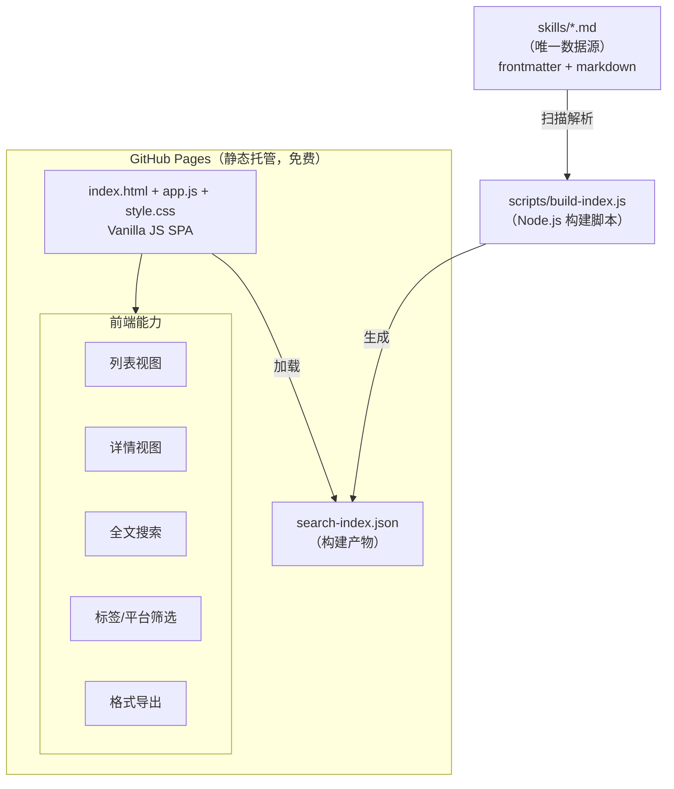

# Skill Gallery 设计文档

> 个人 skill 管理与索引系统：统一入库、快速查找、跨平台复用、易于分享。

## 1. 项目定位

一个托管在 GitHub Pages 上的纯静态个人 skill 画廊。核心目标：

- **统一管理**来自不同来源的有用 skill（自建、GitHub、各 agent 平台、skill 市场）
- **快速查找**：全文搜索 + 标签过滤，秒级定位
- **方便分享**：URL 直达具体 skill，支持导出为各平台格式
- **极易维护**：零构建工具链，数据即文件，添加 = 新建一个 markdown

非目标（不做）：
- 用户系统、评论、点赞等社交功能
- 多用户协作编辑
- 完美兼容所有 agent 平台的格式转换
- 服务端、数据库

## 2. 总体架构



**核心原则：** `skills/` 目录是唯一数据源。所有内容改了，重新跑一次构建脚本，前端跟着变。

## 3. 数据模型

### 3.1 目录结构

```
skill-gallery/
├── skills/                      # 所有 skill 数据文件
│   ├── systematic-debugging.md
│   ├── code-review-assistant.md
│   └── ...
├── index.html                   # SPA 入口
├── assets/
│   ├── app.js                   # 前端逻辑
│   ├── style.css                # 样式
│   └── search-index.json        # 构建产物，前端加载
├── scripts/
│   └── build-index.js           # 构建脚本
└── specs/
    └── 2026-08-02-skill-gallery-design.md
```

### 3.2 Skill 文件格式

每个 skill 是一个 `.md` 文件，文件名即 `slug`（URL 友好标识）。

```markdown
---
name: Systematic Debugging
description: Step-by-step debugging workflow for any bug
tags: [debugging, workflow, problem-solving]
platforms: [codex, claude-code, generic]
source: self-built
source_url: https://github.com/...
author: Your Name
created_at: 2026-08-02
updated_at: 2026-08-02
usage_notes: |
  在定位难以复现的 bug 时特别有用，
  记得先从复现步骤开始。
---

# Systematic Debugging

## Overview
...skill 正文...
```

### 3.3 字段定义

| 字段 | 类型 | 必填 | 说明 |
|---|---|---|---|
| `name` | string | ✓ | 显示名称 |
| `description` | string | ✓ | 一句话描述，用于列表和搜索摘要 |
| `tags` | string[] | ✓ | 标签数组，用于分类和筛选 |
| `platforms` | string[] | ✓ | 适用平台：`codex` / `claude-code` / `cursor` / `cline` / `generic` / 其他 |
| `source` | string | ✓ | 来源类型：`self-built` / `github` / `marketplace` / `platform-native` / `other` |
| `source_url` | string | ✗ | 原始链接 |
| `author` | string | ✗ | 原作者 |
| `created_at` | date | ✓ | 添加日期 (YYYY-MM-DD) |
| `updated_at` | date | ✓ | 最后更新日期 |
| `usage_notes` | string | ✗ | 个人使用心得 |
| 正文 | markdown | ✓ | skill 内容 |

### 3.4 索引文件格式

`assets/search-index.json` 是一个数组：

```json
[
  {
    "slug": "systematic-debugging",
    "name": "Systematic Debugging",
    "description": "...",
    "tags": ["debugging", "..."],
    "platforms": ["codex", "generic"],
    "source": "self-built",
    "source_url": null,
    "author": "...",
    "created_at": "2026-08-02",
    "updated_at": "2026-08-02",
    "usage_notes": "...",
    "content": "纯文本正文，去掉 markdown 标记..."
  }
]
```

`content` 字段用于全文搜索，去掉了 markdown 格式标记以减少噪音。

## 4. 前端设计

### 4.1 技术选型

- **纯 Vanilla JS**：不使用框架，无构建工具
- **全文搜索**：minisearch（~30KB gzipped，CDN 引入）
- **Markdown 渲染**：marked.js（CDN 引入）
- **路由**：hash 路由（`#/` 和 `#/skill/<slug>`）

选择理由：零依赖构建，双击 `index.html` 就能跑（fetch 本地 JSON 需要通过静态服务器访问，推荐用 `python3 -m http.server`）。

### 4.2 列表视图 (`#/`)

**布局：**
- 顶部：标题 + 搜索框（实时搜索，200ms 防抖）
- 左侧边栏（桌面）/ 顶部筛选栏（移动端）：
  - 标签云（点击切换筛选，支持多选 AND）
  - 平台筛选
  - 来源筛选
- 主区域：skill 卡片网格（响应式，2-3-4 列自适应）
- 底部/右上：排序切换（更新时间 / 名称） + 总数统计

**卡片内容：**
- 名称（大）
- description（小，一两行截断）
- 标签 badges
- 平台图标（小）
- 来源标记（小图标或 角标）

### 4.3 详情视图 (`#/skill/<slug>`)

- 返回按钮 + 标题
- 右上角：导出下拉菜单
  - 导出为 Codex 格式（SKILL.md）
  - 导出为 Claude Code 格式
  - 复制原始 markdown
  - 复制分享链接
- 兼容性提示条（显眼但不突兀）
- 正文（markdown 渲染）
- 底部元信息：来源链接、作者、日期、使用心得（如果有）

### 4.4 搜索体验

- 实时搜索：输入即搜，无提交按钮
- 搜索范围：name、description、tags、content
- 结果高亮：匹配片段高亮显示
- 空状态：友好提示 + 清空筛选条件

### 4.5 视觉风格

- 干净、信息密度适中
- 暗色 / 亮色模式切换（跟随系统 + 手动切换）
- 8px 圆角卡片，克制的浅边框
- 无多余装饰，工具感强
- 移动端优先响应式

## 5. 构建脚本

### 5.1 功能

`scripts/build-index.js` 做三件事：
1. 扫描 `skills/` 目录下所有 `.md` 文件
2. 解析 YAML frontmatter，提取纯文本正文
3. 输出 `assets/search-index.json`

### 5.2 实现约束

- 只用 Node.js 内置模块（不依赖 npm 包）
- frontmatter 解析用手写解析（几十行，不装包）
- markdown 转纯文本用简单正则去除标记
- 报错信息 + 错误提示，单个文件解析失败不影响整体构建

### 5.3 运行方式

```bash
node scripts/build-index.js
```

退出码：成功 / 失败 + 错误信息。

## 6. 添加与部署

### 6.1 本地开发

```bash
# 构建索引：
node scripts/build-index.js

# 本地预览：
python3 -m http.server 8000
# 然后打开 http://localhost:8000
```

### 6.2 部署

- GitHub Pages 直接 serve 整个 repo
- `main` 分支 push 后自动更新
- 可选：GitHub Action 自动构建索引（v1.1，非必须）

### 6.3 添加新 Skill 的流程

**手动阶段（v1）：**

1. 在 `skills/` 下新建 `<slug>.md`
2. 填写 frontmatter + 正文
3. 运行 `node scripts/build-index.js`
4. commit & push

**未来增强（后续）：**

- 半自动导入脚本：`node scripts/import.js <url>`
  - 支持 GitHub 文件/gist 等来源自动抓取
  - 生成草稿文件，手动校对后提交
  - 不是 v1 不实现，v1 只做手动

## 7. 导出功能

### 7.1 设计原则

- 导出在浏览器端完成，不需要服务端
- 格式转换做"尽力而为"，不承诺完美兼容
- 每个导出格式旁边标注说明"可能需要手动调整"

### 7.2 支持的导出格式

| 导出格式 | 说明 |
|---|---|
| Codex SKILL.md | frontmatter + markdown 正文，基本原样输出（统一格式本身就基于 Codex 格式设计） |
| Claude Code skill | 转成 Claude 可用的 markdown 格式（去掉 frontmatter，调整结构） |
| 原始 markdown | 完整文件内容，直接复制 |
| 分享链接 | 当前页面 URL |

### 7.3 兼容性提示

详情页顶部显眼位置显示：
> 此 skill 适用于：[平台 badges]
> 不同 agent 平台格式可能略有差异，导出后可能需要微调。

README 中有专门一节"如何在你的 agent 中使用"，说明各平台的安装方式和注意事项。

## 8. 演进路线

**v1.0（最小可用）**
- [ ] 数据格式 + 构建脚本
- [ ] 列表 + 详情 SPA 单页应用（列表 + 详情）
- [ ] 全文搜索
- [ ] 标签/平台筛选
- [ ] 导出功能
- [ ] README + 使用说明

**v1.1（体验优化）**
- [ ] 暗色模式
- [ ] 键盘快捷键（/ 聚焦搜索，esc 返回列表）
- [ ] GitHub Action 自动构建索引

**v2.0（半自动导入）**
- [ ] import.js 导入脚本
- [ ] GitHub URL / gist 导入
- [ ] 批量导入

## 9. 维护成本估算

- 日常添加一个 skill：~1 分钟（复制粘贴 + 填元数据）
- 构建脚本维护：几乎为零，逻辑稳定后不需要动
- 前端维护：偶尔调整样式或加小功能
- 托管成本：$0（GitHub Pages free tier）

